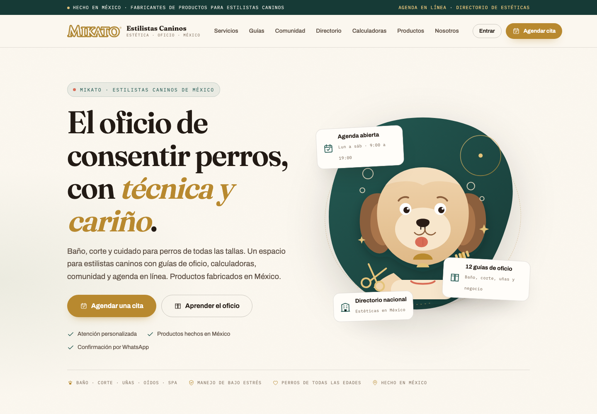
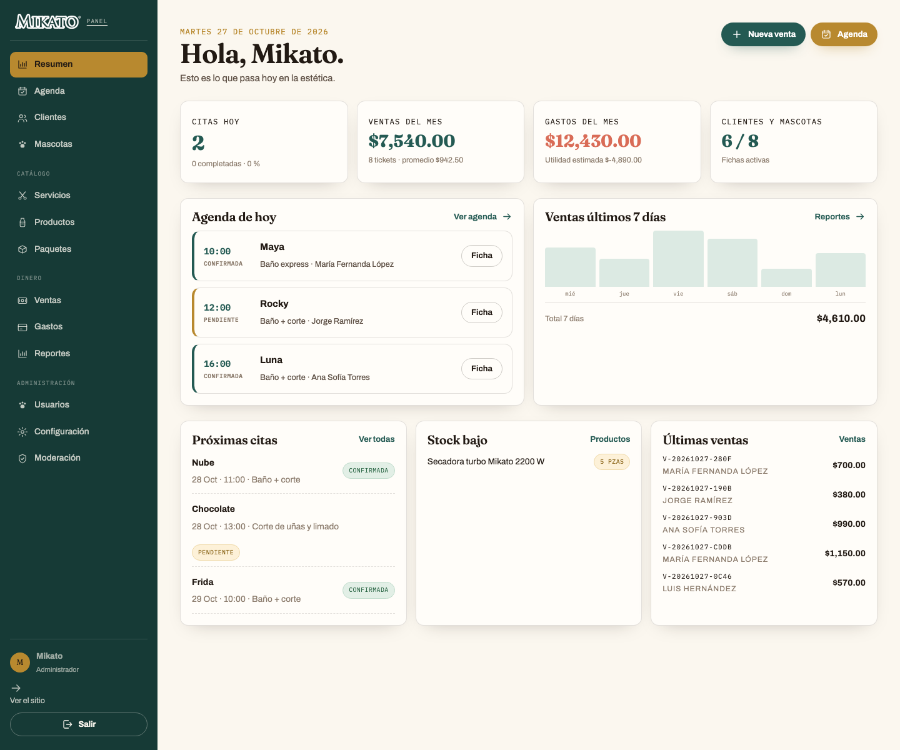

# Mikato Estilistas Caninos

**CRM para estéticas caninas y fábrica de productos profesionales en Guadalajara, Jalisco.** Agenda, clientes, mascotas, inventario, ventas, reportes, guías, calculadoras, directorio y comunidad. Mikato no presta servicios de estética. Hecho en PHP, sin framework y sin build step.

- Sitio: <https://mikatoestilistascaninos.com>
- Repositorio: <https://github.com/Mikato8/New-Est-ticas-Caninas>
- Idioma: español de México · Moneda: MXN
- Arquitectura: PHP 8.3 + PostgreSQL (Neon), misma base que [Electricistas MX](https://github.com/Mikato8/Electricistas), con dominio, datos y frontend propios.



## Qué incluye

### Para clientes de las estéticas

- **Servicios y precios** por tamaño, con duración y alcance claros.
- **Agenda en línea** con selección de servicio, fecha y horario; confirmación por WhatsApp y código de cita.
- **Mi cuenta**: mascotas, próximas citas, historial de estética, compras y perfil.
- **Cuidados antes y después** de la cita, señales para reprogramar y qué llevar en la primera visita.
- **Productos Mikato** elaborados en Guadalajara, Jalisco, con precios de mayoreo, imágenes y enlace a [mikato.com.mx](https://mikato.com.mx).

### Para estilistas caninos

- **12 guías de oficio**: baño, uñas, oídos, corte higiénico, deslanado, manejo de perros nerviosos, secado, primeros auxilios, higiene del equipo, razas, precios y marco legal.
- **4 calculadoras**: dilución de shampoo, precio de servicio, tiempo/costo de secado y rentabilidad por hora.
- **Comunidad moderada** con casos, técnicas, dudas y empleo.
- **Galería de trabajos**: usuarios con cuenta suben fotos o videos a cada guía; los trabajos aparecen en la guía y en el carrusel de la portada.
- **Directorio nacional** de estéticas, con fichas revisadas antes de publicar.
- **Glosario** de 32 términos del oficio.
- **Asistente de búsqueda en servidor** que consulta 164 fragmentos del contenido del sitio con PHP puro, sin JavaScript ni modelos externos.

### Para estéticas (panel de gestión / CRM)

- Agenda por día, estados de cita, reprogramación y creación de citas.
- Envío de la agenda por WhatsApp con enlace privado de 7 días y descarga CSV.
- Clientes, mascotas, historial de estética y alertas de manejo.
- Catálogo de servicios, productos, paquetes e inventario, con imagen de producto y enlace a la tienda.
- Ventas con conceptos, descuentos, métodos de pago y ticket imprimible.
- Gastos, reportes de ventas/utilidad, punto de equilibrio y stock bajo.
- Usuarios con roles (`admin`, `editor`, `estilista`, `cliente`), fecha de acceso y configuración del negocio.
- Moderación de publicaciones, comentarios, fichas del directorio y mensajes.



## Stack

- **PHP 8.3** sin framework: router, vistas, PDO, sesión, CSRF y autenticación propios.
- **PostgreSQL 17 en Neon**; `pdo_pgsql` y respaldo HTTPS (`DB_DRIVER=http`) para hosting sin salida al puerto 5432.
- **HTML + CSS sin JavaScript**: menús CSS, agenda por pasos PHP y ventas con formularios del servidor. Única excepción: el botón **Ver/Ocultar contraseña** en `/entrar` usa un script inline mínimo autorizado por CSP. Tipografías locales (Fraunces + Archivo + IBM Plex Mono).
- **Ver contraseña** en el acceso, sin depender de extensiones del navegador.
- **Confirmaciones PHP** para acciones destructivas (clientes, mascotas, ventas, gastos y moderación), sin diálogos JavaScript.
- **Sin Composer ni npm en producción.** El despliegue es copiar archivos.
- **Asistente sin JS** con búsqueda léxica en PHP sobre un corpus JSON.

## Empezar en local

```bash
git clone https://github.com/Mikato8/New-Est-ticas-Caninas.git
cd New-Est-ticas-Caninas
cp .env.example .env
# Edita DATABASE_URL, ADMIN_PASSWORD y APP_URL
php bin/migrate.php
php bin/seed.php
php bin/build-ia.php
php -S 127.0.0.1:8090 -t public public/router.php
```

Abre <http://127.0.0.1:8090>. El administrador se crea con `ADMIN_USER` y `ADMIN_PASSWORD`.

### Variables de entorno

| Variable | Uso |
|---|---|
| `APP_URL` | URL pública sin slash final |
| `DATABASE_URL` | Cadena de Neon (`postgresql://…?sslmode=require`) |
| `DB_DRIVER` | `auto`, `pdo` o `http` |
| `DB_TIMEOUT` | Segundos de espera por consulta HTTP |
| `ADMIN_USER` / `ADMIN_PASSWORD` | Bootstrap del administrador |
| `SESSION_NAME` / `SESSION_LIFETIME` | Cookie de sesión |
| `UPLOAD_MAX_BYTES` | Límite de imágenes (3 MB por defecto) |
| `VIDEO_MAX_BYTES` | Límite de videos de galería (40 MB por defecto) |
| `POSTS_POR_DIA` / `COMENTARIOS_POR_HORA` / `CITAS_POR_DIA` | Límites antispam |
| `CONTACT_EMAIL` / `WHATSAPP` / `TELEFONO` | Datos de contacto públicos |
| `MAIL_ENABLED` / `MAIL_HOST` / `MAIL_PORT` / `MAIL_USERNAME` / `MAIL_PASSWORD` / `MAIL_ENCRYPTION` | SMTP autenticado para recuperación de contraseña |
| `NEGOCIO_*` | Datos del salón para ticket y configuración |

## Comandos

```bash
php bin/migrate.php       # esquema idempotente
php bin/seed.php          # admin, catálogo, contenido editorial y ejemplos
php bin/build-ia.php      # corpus JSON del asistente
php bin/check.php         # salud de configuración y base
php tests/run.php         # 47 pruebas de dominio
bash bin/deploy.sh         # rsync + migración a Hostinger (requiere .env.produccion)
```

## Estructura

```text
app/
  Core/           Router, Request/Response, PDO, HTTP Neon, sesión, auth, CSRF, vistas
  Domain/
    Estetica/     Dilución, precio, secado y rentabilidad
    Contenido/    Guías de oficio y glosario
  Controllers/    Público, agenda, comunidad, directorio, calculadoras, cuenta, panel, admin
  Repositories/   SQL de usuarios, clientes, mascotas, citas, ventas, gastos, contenido
  Support/        Markdown seguro, slugs, validación, uploads, correo
config/           Configuración por entorno
database/         Esquema PostgreSQL
public/           Único directorio expuesto: index, assets, corpus IA, uploads
views/            Layout público, panel de gestión y administración
bin/              Migración, seed, corpus, salud y despliegue
tests/            Runner sin dependencias
docs/             Arquitectura, despliegue, contenido, investigación
```

## Seguridad

- Contraseñas con `password_hash` (bcrypt) y rehash automático.
- CSRF en todos los POST, cookies `HttpOnly`/`SameSite=Lax` y `Secure` bajo HTTPS.
- Consultas preparadas, escapado de salida y Markdown que no acepta HTML crudo.
- Validación de imágenes por MIME real, tamaño y dimensiones; PHP bloqueado en `uploads/`.
- Límites de intentos de login, publicaciones por día, comentarios y citas por hora/día.
- `.env` fuera de `public_html`; carpetas de código bloqueadas por `.htaccess`.
- Cabeceras CSP, HSTS, `X-Frame-Options`, `nosniff`, `Referrer-Policy` y `Permissions-Policy`.

Ver [SECURITY.md](SECURITY.md).

## Contenido y fuentes

Las guías se contrastaron con ASPCA, AVMA, AAHA y Merck Veterinary Manual. El marco legal se verificó con el DOF, la Cámara de Diputados y la Secretaría Anticorrupción y Buen Gobierno. **No existe una NOM federal específica de estética canina**; la NOM-042-SSA2-2006 regula centros antirrábicos y la NOM-033-SAG/ZOO-2014 regula el sacrificio humanitario. Consulta [buenas prácticas](https://mikatoestilistascaninos.com/buenas-practicas) y [docs/CONTENIDO.md](docs/CONTENIDO.md).

> Nada de esto sustituye la valoración de un médico veterinario. Ante dolor, heridas, fiebre o dificultad para respirar, deriva.

## Despliegue

Hostinger compartido, documento raíz en `public_html`. El código vive en `public_html/` y `.env` un nivel arriba.

```bash
# .env.produccion con APP_URL y DATABASE_URL de producción
bash bin/deploy.sh
```

Pasos completos, DNS, SSL, correo, respaldos y solución de problemas: [docs/DESPLIEGUE.md](docs/DESPLIEGUE.md).

## Estado y limitaciones

- Versión 1.0. Portal, agenda, cuenta, panel, comunidad, directorio, calculadoras y asistente funcionando.
- El **catálogo, los clientes y las fichas del directorio son datos de ejemplo**. Edítalos en el panel antes de publicar.
- El **directorio tiene 4 fichas marcadas como “ejemplo”** para mostrar el diseño. Reemplázalas o elimínalas.
- Recuperación de contraseña por correo con enlace temporal de un solo uso; cada usuario también puede cambiarla en `/perfil`.
- El envío de correo está desactivado (`MAIL_ENABLED=false`) hasta configurar el buzón del dominio.
- El contenido está en español de México. No hay versión en inglés.
- No se incluyen fotos reales de clientes: las ilustraciones son SVG propios y los datos de ejemplo son ficticios.

## Créditos y herramientas abiertas

La arquitectura se inspira en [Electricistas MX](https://github.com/Mikato8/Electricistas) y [Panadería MX](https://github.com/Mikato8/Panaderia). Para el dominio de estética canina se revisaron, sin copiar código incompatible:

- [OpenSalon](https://github.com/clawnify/OpenSalon) (MIT): agenda multi-giro.
- [Groomwise](https://github.com/russkyc/groomwise) (GPL-3.0): CRM de peluquería canina, solo referencia.
- [Pet-Shop-Grooming-Appointment-System](https://github.com/humb1e1989/Pet-Shop-Grooming-Appointment-System-) (Apache-2.0).
- [PetCare](https://github.com/geosem42/PetCare) (MIT): modelo de historial.
- [fci-breeds](https://github.com/paiv/fci-breeds) (MIT): datos de razas.
- [Dog-Breed-120](https://huggingface.co/prithivMLmods/Dog-Breed-120) (Apache-2.0).
- [Qwen2.5-0.5B-Instruct ONNX](https://huggingface.co/onnx-community/Qwen2.5-0.5B-Instruct): modelo evaluado, no usado en producción.
- [SmolLM2-360M-Instruct](https://huggingface.co/HuggingFaceTB/SmolLM2-360M-Instruct) (Apache-2.0): alternativa evaluada, no usada.

Detalle y licencias en [la página de herramientas](https://mikatoestilistascaninos.com/herramientas) y [docs/INVESTIGACION-2026-10-27.md](docs/INVESTIGACION-2026-10-27.md).

## Licencia

- Código: [MIT](LICENSE).
- Contenido editorial: CC BY-SA 4.0 salvo indicación.
- Marcas, normas, datasets y manuales citados pertenecen a sus titulares.
